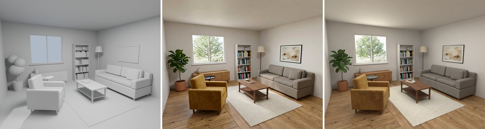
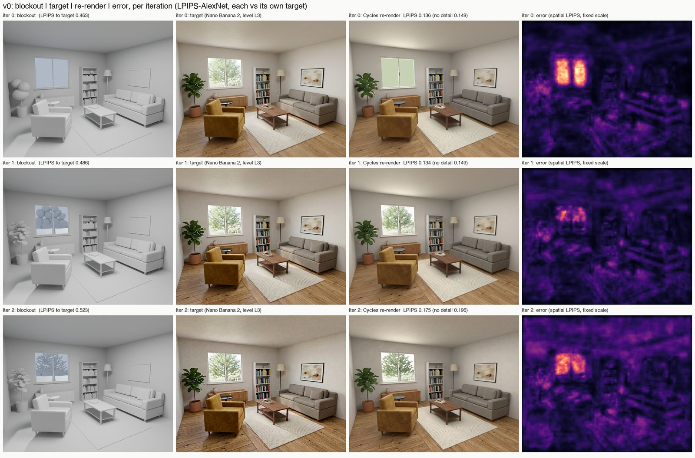
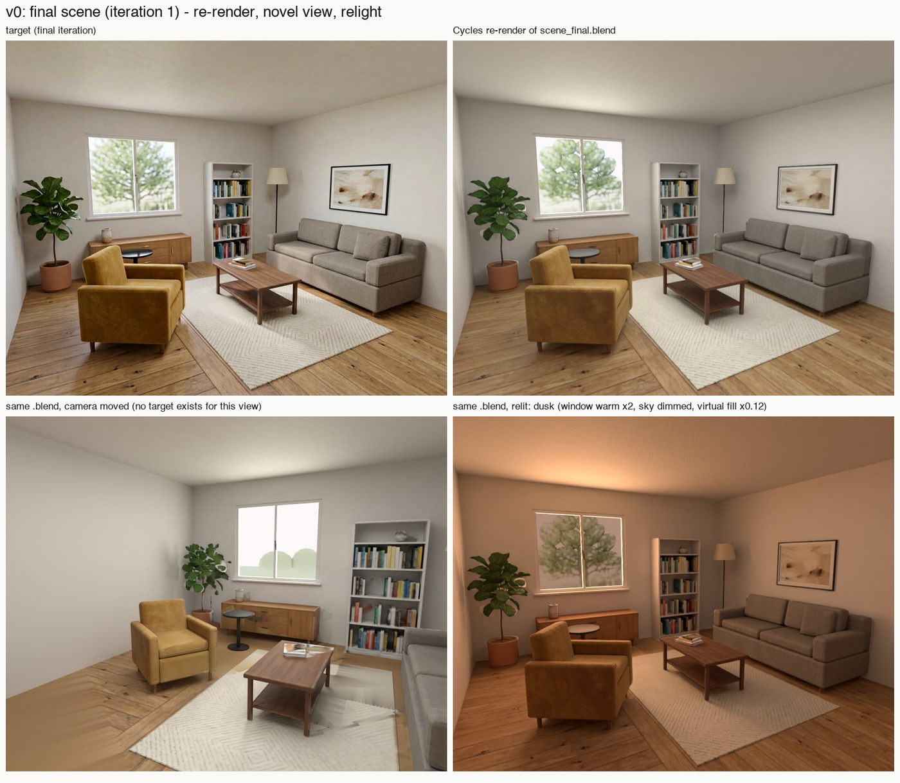
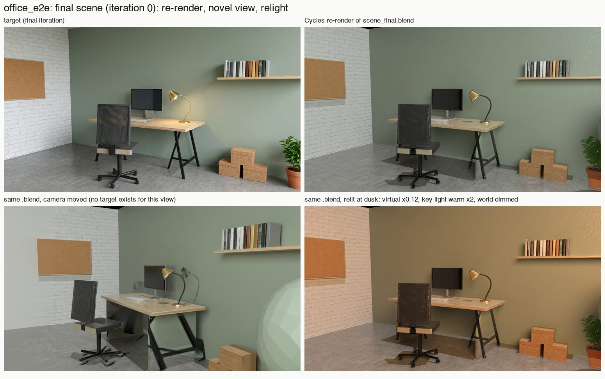

# Blockout 2 Real

**Turn any grey 3D scene into the same scene with real PBR materials and lights, measured against a photo of
its own view.** A skill for coding agents (Claude Code, Codex, Cursor, Copilot, Gemini) that imagines a photo of
the scene's fixed camera view, then writes that look back into the scene: albedo, roughness and normals as each
object's own UV textures, Principled BSDF materials, lights fitted through Cycles, and geometry edits from a
fresh reviewer. The result is an ordinary `.blend` you can edit, relight and render from another camera.

The next step after [Video 2 GLSL](https://github.com/gokayfem/shader-skills),
[Video 2 Blender Nodes](https://github.com/gokayfem/video-to-blender),
[Video 2 Physics](https://github.com/gokayfem/video-to-physics),
[Video to CSS](https://github.com/gokayfem/video-to-css) and
[Image 2 Sculpt](https://github.com/gokayfem/image-to-sculpt). Image 2 Sculpt rebuilds the shape of one object
and leaves scenes, rooms and PBR texturing out. This one takes a whole scene whose shapes already exist and
gives it materials and light.

<p align="center"></p>

<p align="center"><sub>The grey blockout as it started (left), the generated target of the same view for the final iteration (middle), the Cycles re-render of the final scene (right). LPIPS-AlexNet: 0.463 from the blockout to the first target, 0.134 from this re-render to its target. The tree outside the window is ellipsoids with foliage texture on them, and a careful viewer sees it.</sub></p>

## Why

Ask an agent to "make this Blender scene look real" and it tweaks colours and adds an HDRI by eye, or renders
the scene and runs the image through an image model. The first is a guess nobody measures. The second gives a
nice picture and no scene: move the camera or change the light and it is gone. The usual failures go unnoticed:

- the image model moves, resizes or adds objects, and nothing checks the photo against the scene's own layout;
- shading baked into the "albedo" (a sun patch on the floor, a shadow under the sofa) becomes paint;
- roughness from an estimator follows the lighting instead of the material;
- the light rig is whatever fits a linear error, including a weak sun that paints hard patches;
- most of the light comes from a fill that nothing in the scene explains, and nobody says so;
- the score improves because the reference image changed, not because the scene did.

This toolkit gives the agent a method and the tools to do it properly:

- **The photo is a target, never a texture to paste.** Nano Banana 2 turns the grey render into a photo of the
  same view. Its conditioning is a five-level ladder; the weakest level whose edges still line up with the
  object-id mask is kept, and the agent checks the sweep by eye because the edge rule cannot see an object that
  moved but kept its outline.
- **The look is decomposed, then checked.** Marigold V2 albedo, MoGe-3 normals and metric depth, roughness from
  PATINA or (when PATINA's follows the lighting) Marigold-IID Appearance locally, plus a lighting estimate. Each
  map is checked against the scene before it is used.
- **Back-projected into the scene's own UVs.** Every texel is projected through the known camera, tested for
  visibility, and sampled from its own object only. What the camera cannot see is filled from the same
  object's seen texels, and the fractions are recorded.
- **Lights are fitted, not placed by eye.** Each candidate light is rendered alone in Cycles with the real
  materials; a non-negative solve finds their strengths and colours against the target; lights that do not
  earn their place are pruned; two pruning margins are compared by LPIPS.
- **Measured, then critiqued by someone who has not seen the work.** LPIPS and a per-object error map after
  every iteration; small errors become bump detail kept only where it helps; large ones go to a fresh reviewer
  that sees only the two images, and its list becomes geometry edits.
- **Scored as a matrix.** The target is regenerated each iteration and drifts, so every scene is scored against
  every target, and a blind judge sees only blockout, target and re-render.

## Any input

| Input | What happens |
|---|---|
| A `.blend` with a camera | the main path: a grey copy with one UV map, id and description per object |
| A `.blend` without a camera | a camera `b2r_camera` is placed to frame every object; check the preview |
| glTF/GLB, OBJ, FBX, USD, PLY, STL | imported into Blender, one object per mesh (or per collection or parent: `--group-by`), a camera placed if there is none |
| A JSON scene spec of primitives | built in Blender (boxes, cylinders, cones, spheres, planes), camera from the spec |
| Only an idea | the agent writes the scene spec, then the same path |
| A photoreal image of this exact view | `target --image`: used as the target instead of a generated one |
| No API key | not supported: `target` and `decompose` need fal; there is no offline path |

After scaffolding, the agent writes the case's `look` (place, style, time of day, light) and every object's
description (material, colour, finish) itself: they are the whole target prompt, and nothing about a
particular scene lives in this repository. Developed on one interior room, then run unchanged on a second,
unrelated scene (below). Glass and mirrors, foliage made of primitives, animation and several cameras are out
of scope, and the skill says so before starting.

## Install

**Claude Code** (plugin marketplace):

```bash
claude plugin marketplace add gokayfem/blockout-to-real
```

```bash
claude plugin install blockout-to-real@blockout-to-real
```

Or copy the skill: `cp -R skills/blockout-to-real ~/.claude/skills/`.

**Codex, Cursor, Gemini CLI, Copilot and other agents** (via [skills](https://github.com/vercel-labs/skills)):

```bash
npx skills add gokayfem/blockout-to-real
```

Or install by hand:

- **Codex:** copy `skills/blockout-to-real` to `~/.agents/skills/`.
- **Cursor:** copy it to `~/.cursor/skills/`, plus the rule in `adapters/cursor/`.
- **Copilot:** `gh skill install gokayfem/blockout-to-real blockout-to-real`, plus `adapters/copilot/`.
- **Gemini CLI:** `gemini extensions install https://github.com/gokayfem/blockout-to-real`.

**claude.ai:** zip `skills/blockout-to-real` and upload it under Settings > Capabilities > Skills.

**ChatGPT, Gemini Gems and other chat tools:** see [`adapters/`](adapters/).

Requirements: Python 3.10+ with `numpy`, `scipy`, `scikit-image`, `Pillow`, `opencv-python-headless`, `torch`,
`torchvision`, `lpips`, `fal-client`, `plyfile` and `trimesh` (`pip install -r requirements.txt`; uncomment its
optional block for local Marigold-IID roughness), Blender 5.2+ (`$BLENDER`, `blender` on PATH, or the macOS
app) for every geometry, render and material stage, and a fal API key in `FAL_KEY` for the target and the
decomposition. `python3 skills/blockout-to-real/scripts/b2r.py doctor` checks all of it (the key is never
printed).

## Use

Ask naturally, for example:

- *"Make this blockout look real: `attic.blend`."*
- *"Give this greybox real materials and lighting, late afternoon, warm."*
- *"Here is a render of my scene from the camera, painted over in Photoshop. Put that look into the scene."*
- *"Build me a small café interior and make it look like a photo."*

The agent scaffolds a case, writes the look and the object descriptions, checks every sheet, and runs the
stages:

```bash
python3 skills/blockout-to-real/scripts/b2r.py new cases/attic --input attic.blend --look "sunlit attic study, oak beams, late afternoon"
python3 skills/blockout-to-real/scripts/b2r.py run cases/attic --iter 0
```

`run` does the looped stages of one iteration in order. Each stage also runs on its own:

| Command | What it does |
|---|---|
| `doctor` | checks Python packages, Blender and `FAL_KEY` |
| `new` | scaffold a case: the input copied with its sha256, a grey blockout with one UV map, id and description per object |
| `gbuffers` | depth, normals, position, object ids and the grey beauty render of the fixed camera (EXR + PNG) |
| `target` | the photo of the same view: the conditioning ladder and its edge rule (`--set-level` to override), or `--image` for your own |
| `decompose` | albedo, roughness, metallic, normals, metric depth and a lighting estimate from the target |
| `backproject` | the maps into each object's UV textures, fills for unseen texels, Principled BSDF materials |
| `relight`, `relight-select` | lights fitted against the target from Cycles basis renders; the fit kept by LPIPS |
| `residual`, `detail` | LPIPS, per-object error map, contact sheet; small errors as bump detail, kept only where it helps |
| `critique`, `edit` | pack target and re-render for a fresh reviewer (`--judge`: the blind judge) and store its answer (`--save`); apply geometry items as the next iteration's blockout |
| `finalize`, `report` | final `.blend`, LPIPS matrix, novel view, relights, contact sheets; `REPORT.md` |
| `render`, `inspect` | render any `.blend` from a moved camera or with scaled and tinted lights; prove a `.blend` is ordinary |
| `status` | which stages each iteration has, and the fal spend against the budget |

Every paid call goes through a per-case budget (`--budget`, estimated per call) and is logged in
`fal_calls.jsonl`. The first run cost about $1.47 for three iterations: 14 Nano Banana 2 calls, 8 Marigold V2,
4 PATINA and 4 MoGe-3.

## How a case runs

| Phase | Deliverable | Checked by |
|---|---|---|
| Scaffold | `case.json` with `look`, the grey blockout, `objects.json`, a preview | a person reads the descriptions and the preview |
| G-buffers | depth, normals, position, ids, grey beauty, camera | a reprojection self-check |
| Target | five ladder levels, the chosen target, `choice.json` | the edge rule against the id mask; the agent looks at the overlays |
| Decompose | albedo, roughness, metallic, normals, metric depth, lighting estimate | per-map checks (flatness, shading leak, normal agreement); the map sheet |
| Back-project | per-object UV textures, Principled materials, `coverage.json` | an unlit round trip against the albedo; novel-view renders |
| Relight | fitted lights with units and energy shares, two variants | the fit's R²; LPIPS picks the variant |
| Residual | LPIPS, error map, per-object table, contact sheet, bump detail | LPIPS against the target; per-object LPIPS for the detail |
| Critique and edit | a fresh reviewer's list, the next iteration's blockout | the next iteration's scores |
| Finalize | `scene_final.blend`, LPIPS matrix, novel view, relights, `judge.json` | `inspect`; a blind judge; a person |

## The first run

One interior room, one fixed camera, three iterations, on an Apple M4 with Blender 5.2.2 and Cycles. LPIPS
(AlexNet, lower is better), each iteration against its own target:

| Iteration | Blockout | Re-render | + detail bump | What changed going in |
|---|---|---|---|---|
| 0 | 0.463 | 0.149 | 0.136 | — |
| 1 | 0.486 | 0.149 | 0.134 | plant rebuilt as a fig; garden tree, lawn and treeline added |
| 2 | 0.523 | 0.196 | 0.175 | tree rebuilt with fine foliage |

The target drifts, so every scene was also scored against every target:

| | target 0 | target 1 | target 2 | mean |
|---|---|---|---|---|
| scene 0 | 0.136 | 0.162 | 0.216 | 0.171 |
| scene 1 | 0.118 | 0.134 | 0.182 | 0.145 |
| scene 2 | 0.135 | 0.140 | 0.175 | 0.150 |

Iteration 1 improved against both fixed targets although its own-target number barely moved; iteration 2 did
not, so the loop stopped and scene 1 is the final scene: 20 mesh objects (8,858 faces), one Principled BSDF per
object with base colour, roughness, metallic, normal and bump textures in its own UVs, 119 packed images, no
emission shaders, no compositor, no image planes.

<p align="center"></p>

<p align="center"><sub>Every iteration: grey blockout, target, Cycles re-render, spatial LPIPS error on a fixed scale. The error is brightest on the window. The finer tree of iteration 2 (bottom) read as polka dots and scored worse.</sub></p>

<p align="center"></p>

<p align="center"><sub>The final scene is real 3D: the same <code>.blend</code> from a moved camera (bottom left; no target exists for that view, so the floor under the furniture is smeared and the far wall is a flat fill) and relit for dusk (bottom right; window warmer, sky dimmed, virtual fill scaled to 0.12).</sub></p>

What it is not:

- **Not photo-indistinguishable.** A blind judge shown only blockout, target and re-render placed the re-render
  at 8.5 of 10 towards the target and said a careful viewer would call it CG: first the tree outside the window
  (ellipsoids with foliage texture, severity 5), then flat light and weak contact shadows.
- **More than half the light is virtual.** Window area light 34% of image energy, sky 11%, a hidden ceiling fill
  55%. The light fit reaches R² about 0.84 against the target only with it.
- **One view.** Surfaces the camera never saw are filled; from a moved camera the fills show.
- **Roughness is weak.** PATINA's roughness followed the lighting and was rejected; the local Marigold-IID map
  is blurry, and the glossy black side table renders grey. Metallic was 0 everywhere.
- **The detail bump is partly view-fitted.** It takes about 0.013 off LPIPS at this camera and would not fully
  carry to another.
- **The target comes from a closed API model** (Nano Banana 2 on fal).

The failures of that run and the rule each became are in
[`references/lessons.md`](skills/blockout-to-real/references/lessons.md).

## A second input

To check that nothing depends on the first scene, the same commands were run on a scene made separately: a
home-office corner on an open two-wall set, given as a `.blend` with its own materials, bevel, array and
subdivision modifiers, an instanced collection, a curve, two lights and a 16:9 camera. `new` produced 31
objects with ids, UV maps and descriptions; the generator's 16:9 size (1376x768) was learned on first use;
one iteration ran with no change to the code.

| | LPIPS-AlexNet to the target |
|---|---|
| Grey blockout | 0.574 |
| Cycles re-render | 0.281 |
| + detail bump | 0.222 |

The scene's own softbox stayed the main light after the fit (60% of image energy), with a sun (24%) and a
virtual fill behind the camera (15%). The final `.blend` has 31 mesh objects and 182 packed textures. It cost
about $0.49.

<p align="center"></p>

<p align="center"><sub>Iteration 0 only, with no critique or edits and the object descriptions left as ingest wrote them. The generator drew A-frame trestles where the blockout has slab legs and put the plant somewhere else; both were painted onto whatever geometry was there, and the fitted sun casts harder shadows than the target has. That gap is what the critique-and-edit loop is for.</sub></p>

## Verification

| Check | Where | What it proves |
|---|---|---|
| Case contract | `tests/test_common.py` | nearest generator aspect ratio, stage folders, `case.json` round trip, script arguments |
| Camera and geometry edits | `tests/test_geometry.py` | projection and unprojection against closed forms, Euler round trips, ellipsoid fits recover known axes and separate blobs, a fitted part's silhouette |
| Target edge rule | `tests/test_target.py` | aligned edges score high against a synthetic id map; misaligned or blank images score low |
| Light solve | `tests/test_relight.py` | known non-negative light weights are recovered from synthetic basis images; a useless light is pruned |
| Residual | `tests/test_residual.py` | the small / large rule, per-object rows with the open-sky row, the detail band and mask; with `--slow`, real LPIPS on a re-render with one wrongly coloured object |
| Reviewer answers | `tests/test_critique.py` | valid critique and judge JSON passes, malformed answers are rejected, the prompts state the answer's shape |

```bash
python3 tests/run_tests.py           # 22 fast tests (numpy, scipy, Pillow, opencv)
python3 tests/run_tests.py --slow    # + the LPIPS test (torch and the LPIPS weights)
```

CI (`.github/workflows/checks.yml`) runs the fast tests, `b2r.py --help` and a compile of every script on
Linux without Blender, fal or a GPU. The tests check the tools on inputs with known answers. They do not run
Blender or the models, and they do not prove that a scene ends up looking real; that is what the contact
sheets, the matrix and the blind judge are for.

## Layout

```text
skills/blockout-to-real/   the skill: SKILL.md, references/, templates/, scripts/ (b2r CLI, library, Blender scripts)
tests/                     python3 tests/run_tests.py [--slow] (synthetic inputs with known answers)
adapters/                  prompts for assistants without skill support
gallery/                   README images from the first run and the second input
```

Cases and everything they produce live outside the repository (`cases/` is git-ignored).

## Credits

See [CREDITS.md](CREDITS.md). MIT licensed.
